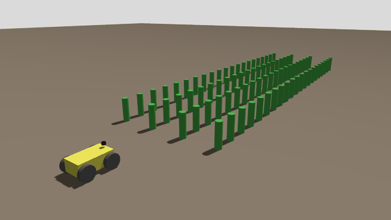
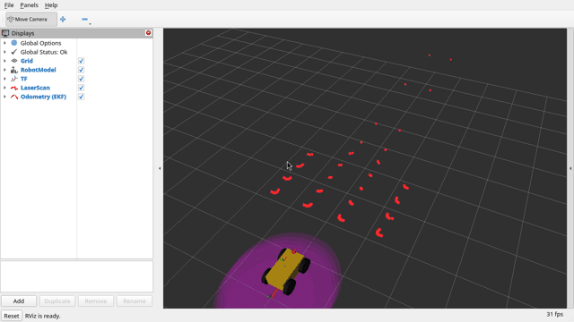
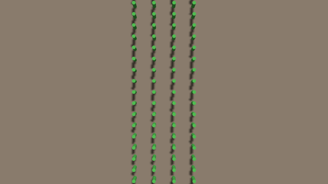
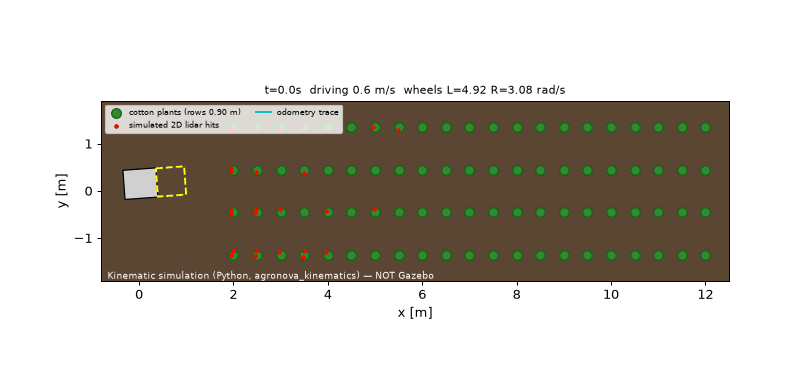
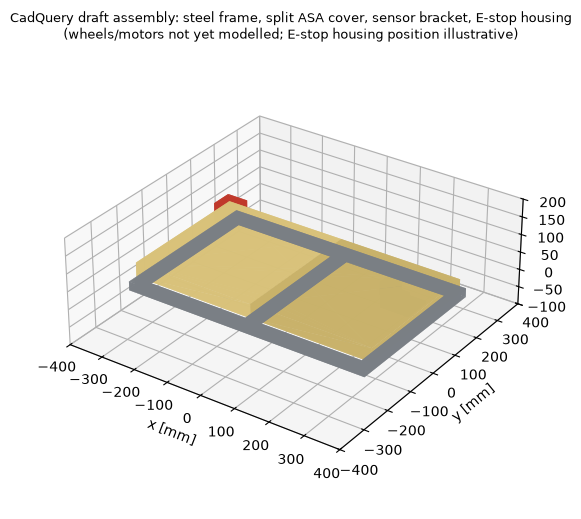
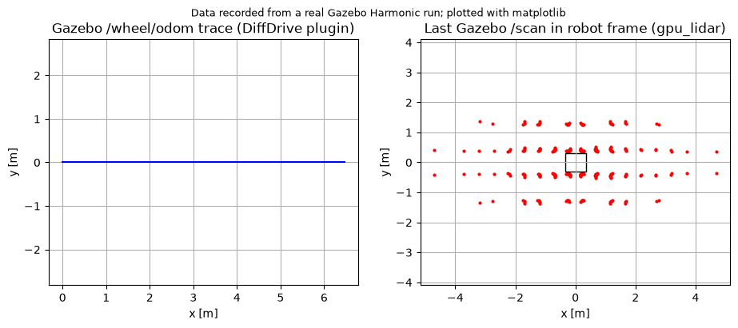

# AgroNova — Open-Source Agricultural Robot

AgroNova is a modular, open-source agricultural robotics platform: field mobility, interchangeable tools, sensors, manual + autonomous operation, and remote diagnostics.

> **Baseline:** smallholder cotton/soybean rows in Maharashtra (SRS A-0). **Project status: Phases 1–4 in progress.** Nothing here has been manufactured or physically validated. See [docs/STATUS.md](docs/STATUS.md).

## Baseline architecture (proposed, pending Gate 1 review)
```
 Operator / Ground station ──(Wi‑Fi/LTE, ROS 2 DDS)──┐
                                                     ▼
  High-level computer (Raspberry Pi 5 baseline, TBD) — ROS 2 Jazzy
   ├─ agronova_kinematics (diff-drive FK/IK, odometry)
   ├─ Nav2 / robot_localization (planned)
   └─ agronova_bringup, agronova_description (URDF)
                     │ UART / micro-ROS (TBD)
                     ▼
  Real-time controller (ESP32 baseline, TBD) — firmware/motor_controller
   ├─ motor drivers → 4× DC gearmotors (skid-steer)  [models TBD]
   ├─ encoders, watchdog, comms-loss stop
   └─ HARDWARE E-stop chain cuts motor power independently of software
```

## Visuals
| | |
|---|---|
|  |  |
| **Gazebo Harmonic** (real headless run, ogre2 camera sensor in `cotton_field_capture.sdf`) — robot driving the 0.90 m inter-row | **RViz2** (real screenshot under Xvfb): RobotModel, TF, Gazebo `/scan`, EKF `/odometry/local` |
|  |  |
| Gazebo top-down camera | **Python kinematic simulation** (not Gazebo) using `agronova_kinematics`: lidar ray-casting + stop-zone halt for a person |
|  |  |
| CadQuery draft assembly (matplotlib render) | Odometry trace + lidar scan recorded from the Gazebo run |

How each was made and how to regenerate: [docs/simulation/README.md](docs/simulation/README.md#visuals).

## Repository layout
| Path | Contents |
|---|---|
| `docs/requirements/` | SRS, assumptions, traceability matrix |
| `docs/{mechanical,electronics,firmware,ros2,simulation,kinematics,testing,manufacturing,deployment,safety}` | Discipline docs |
| `ros2_ws/src/` | ROS 2 packages (description, bringup, kinematics) |
| `firmware/motor_controller/` | PlatformIO ESP32 motor-controller skeleton |
| `hardware/cad/cadquery/` | Parametric CadQuery source; `hardware/step/`, `hardware/stl/` generated exports (PCB: not started) |
| `docs/calculations/` | Sizing results generated by `tools/sizing.py` |
| `docs/safety/` | Safety functions, FMEA, risk register |
| `ros2_ws/src/agronova_gazebo`, `agronova_navigation` | Gazebo world/sim launch; Nav2 + EKF configs |
| `ci/ci.yml` | GitHub Actions workflow — move to `.github/workflows/` to enable |
| `bom/` | BOM templates (all parts TBD) |
| `tools/` | `check_printability.py` — STL vs Neptune 4 Max envelope |
| `tests/` | Repo-level Python tests |

## Quick start
```bash
pip install -r requirements-dev.txt   # + cadquery to regenerate CAD
pytest -q                               # kinematics + tool tests
# ROS 2 (Jazzy): cd ros2_ws && colcon build && colcon test
# Firmware: cd firmware/motor_controller && pio run
```

## Development phases
Phases 1–8 and Gates 1–8 are tracked in [docs/STATUS.md](docs/STATUS.md). No gate is marked complete without evidence.

License: MIT. Contributions welcome — see [CONTRIBUTING.md](CONTRIBUTING.md).
